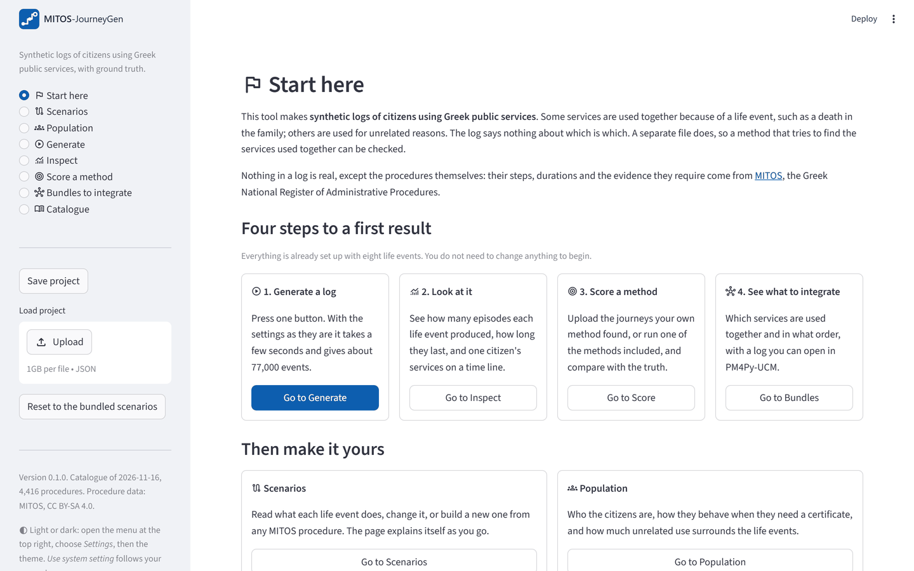
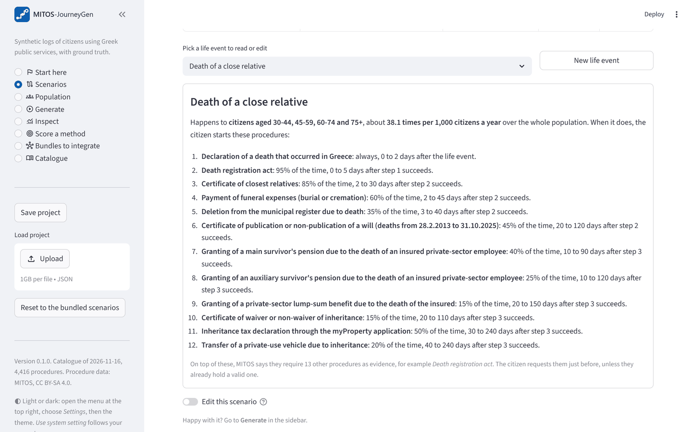
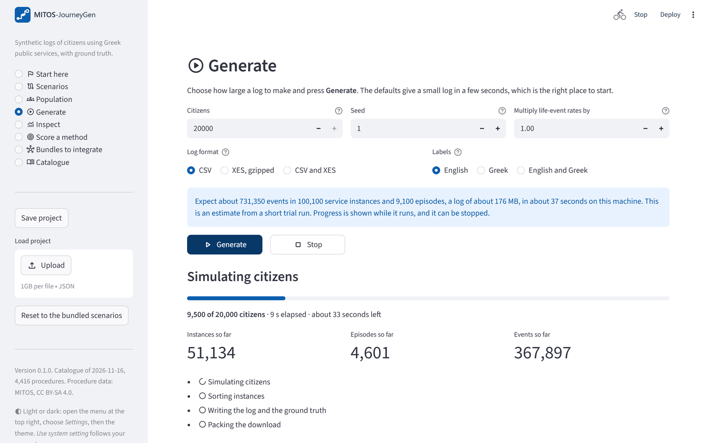
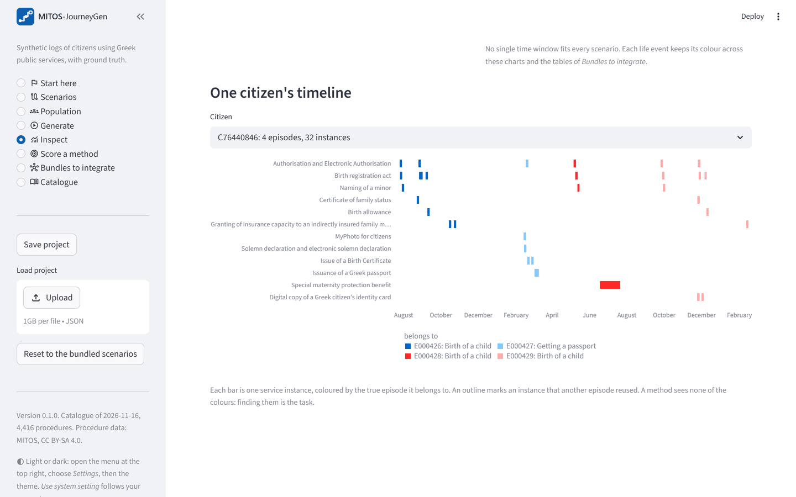
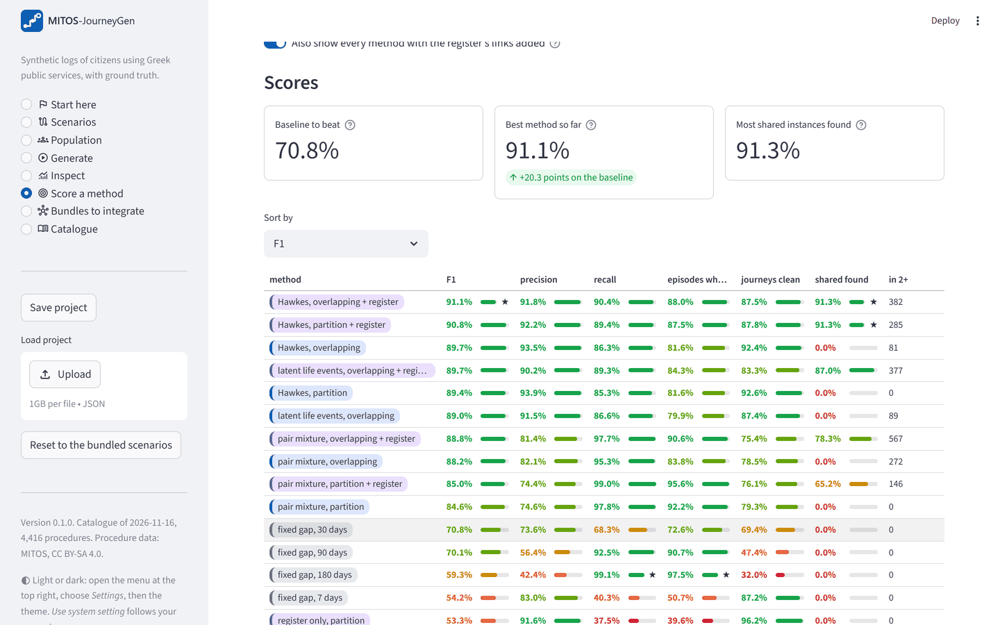
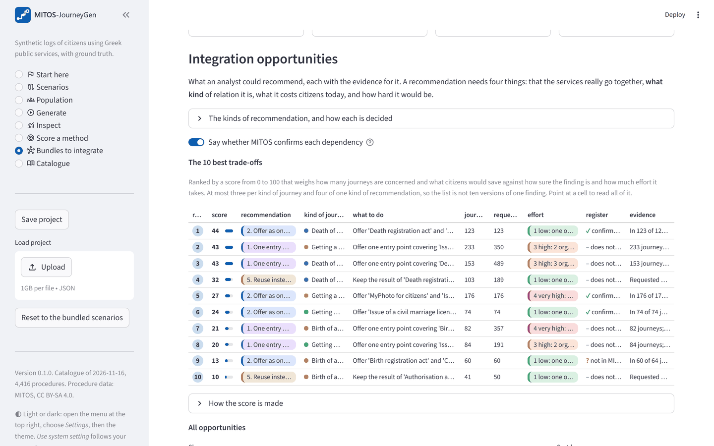
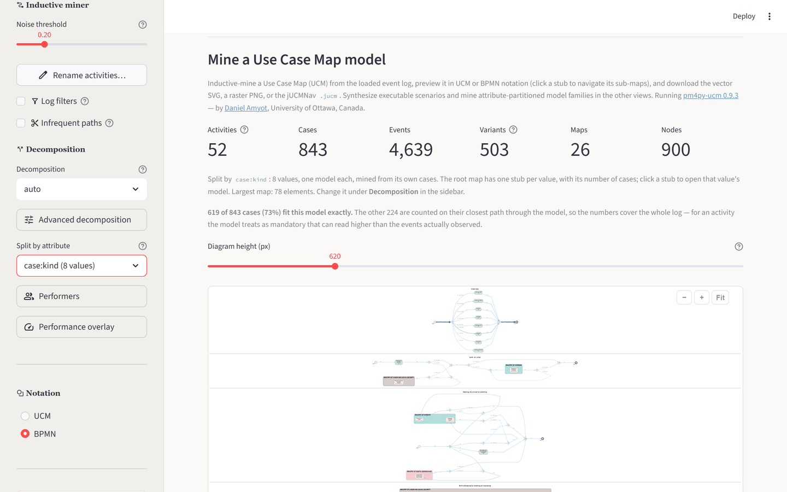
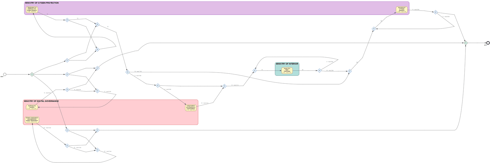

<p align="center">
  <picture>
    <source media="(prefers-color-scheme: dark)" srcset="assets/logo_dark.svg">
    
  </picture>
</p>

<p align="center">
  <a href="https://mitos-journeygen.streamlit.app"><b>Open the app</b></a> ·
  <a href="docs/presentation/MITOS-JourneyGen-introduction.pdf"><b>Introduction slides</b></a> ·
  <a href="docs/methods.md"><b>Method guide</b></a> ·
  <a href="https://processmining-uottawa.github.io/MITOS-JourneyGen/"><b>API documentation</b></a> ·
  <a href="docs/testing.md"><b>Tests</b></a> ·
  <a href="CHANGELOG.md"><b>Changelog</b></a>
</p>

# MITOS-JourneyGen: synthetic logs of citizens using public services

A generator of event logs in which citizens use several Greek public services,
some of them together because of a life event (a death in the family, a birth,
a job loss) and some of them for unrelated reasons. It exists to test methods
that look for services commonly used together, so that those services can be
integrated or bundled.

**The data is synthetic.** No citizen, case or timestamp is real. What is real
is the structure: every service follows the published step tree of a procedure
in [MITOS](https://mitos.gov.gr), the Greek National Register of Administrative
Procedures, and the evidence one procedure needs from another comes from MITOS
too.



## Introduction in slides

New here? The slides walk through the base example (2,000 citizens, seed 1)
from the question to a recommendation: the MITOS catalogue, a life event,
generating and inspecting the log, finding journeys and scoring the methods,
the ranked integration opportunities, and the journey log opened in
[PM4Py-UCM](https://github.com/ProcessMining-uOttawa/pm4py-ucm), split into one
model per kind of journey. Every slide has speaker notes.

- [Read the slides (PDF, 23 pages)](docs/presentation/MITOS-JourneyGen-introduction.pdf)
- [Download them for PowerPoint (PPTX)](docs/presentation/MITOS-JourneyGen-introduction.pptx)

The hosted app is at <https://mitos-journeygen.streamlit.app>. When it has
not been used for a while it sleeps, and waking it takes about a minute.

## Quick start

Python 3.10 or later. The generator uses the standard library only; the methods
in `prototype/` need `pip install -r prototype/requirements.txt`.

```bash
python generate.py --citizens 2000 --seed 1 --out out/
```

```bash
python generate.py --describe
```

The first command writes the dataset. The second prints each scenario with the
evidence MITOS attaches to its procedures, and generates nothing.

`--format xes` writes the log as XES instead of CSV, and `--format both` writes
the two; add `--gzip` for `events.xes.gz`. A trace is one service instance, and
every event carries its completion in `time:timestamp` and its start in
`start_timestamp`, the convention PM4Py reads as an interval log. The ground
truth is CSV either way. A run of more than a few seconds reports its progress.

## Command lines

Everything the app does is also a command; each one explains its options
with `--help`. They read and write plain files, so they can be chained:

```bash
python generate.py --citizens 2000 --seed 1 --out out/
```

```bash
python prototype/hawkes.py out/
```

```bash
python prototype/score.py out/
```

```bash
python bundles.py out/ --journeys out/journeys_hawkes.csv
```

| Command | What it does | Main options |
|---|---|---|
| `generate.py` | Writes a log, its ground truth and a manifest | `--citizens` (2000), `--seed` (1), `--out` (`out/`), `--format csv\|xes\|both`, `--gzip`, `--lang en\|el\|both`, `--rate-scale` (a stress test), `--scenarios`, `--catalogue`, `--translations`, `--describe` (print the scenarios, generate nothing), `--version` |
| `bundles.py FOLDER` | From journeys to an answer: the journey-level log for PM4Py-UCM and the ranked integration opportunities | `--journeys` (a method's journeys; the true episodes otherwise), `--min-size` (2), `--no-register` |
| `prototype/discover.py FOLDER` | Journeys by a delay mixture per pair of services | `--link-at` (0.5) |
| `prototype/hawkes.py FOLDER` | Journeys by a Hawkes process | `--verbose` |
| `prototype/latent.py FOLDER` | Journeys and their kinds by a latent life-event model | `--kinds` (12), `--restarts` (3), `--verbose` |
| `prototype/register.py FOLDER` | Journeys from MITOS's evidence links alone | `--catalogue`, `--validity-days` (90) |
| `prototype/score.py FOLDER` | Scores every `journeys*.csv` in the folder against the truth, beside fixed-gap baselines | |
| `build_catalogue.py` | Downloads MITOS and rebuilds `catalogue.json.gz` (about a quarter of an hour) | `--cache` (required), `--offline` (rebuild from the cache), `--out` |
| `catalogue_changes.py OLD NEW` | What changed between two catalogues, and which scenarios it touches | `--scenarios`, `--json`, `--log`, `--force` (accept more than 5% withdrawn) |
| `streamlit run app.py` | The web app (port 8612 with `run_local.cmd` or `run_local.sh`) | |

The prototypes need numpy, pandas and scipy (`pip install -r
prototype/requirements.txt`); `generate.py` needs only the standard library. What each
method does is in [docs/methods.md](docs/methods.md), and every function is
in the [API documentation](https://processmining-uottawa.github.io/MITOS-JourneyGen/).

## In the browser

```bash
pip install -r requirements.txt
```

```bash
streamlit run app.py
```

Streamlit's default port, 8501, is often taken by another app. `run_local.cmd`
(Windows) and `run_local.sh` start this one on port 8612 instead.

The app does what the command line does, with nothing of its own added. It
opens on a **Start here** page that introduces every entry of the menu: four
steps to a first result with the bundled scenarios, the three views that shape
them, and the words the tool uses.

- **Scenarios.** Each life event is first told as a story in sentences: who it
  happens to, how often, which procedures it starts, how likely and when.
  *Edit this scenario* opens four numbered steps: how often, which procedures
  (added by searching the whole catalogue), the evidence the register
  attaches, and a look at a procedure's steps. Every value is marked as coming
  from MITOS or as your assumption.
- **Population.** Age groups, regions, behaviour and background use.
- **Generate.** Citizens, seed, rate multiplier, CSV or XES, language. An
  estimate of the size and time comes first, from a short trial run. While it
  runs the app shows citizens done, time elapsed and time left, running counts
  and the stage it is in, and the run can be stopped. The result is one zip.
- **Inspect.** Counts, episodes per scenario, how long episodes last, and one
  citizen's instances on a time axis, coloured by true episode.
- **Bundles to integrate.** Which services are used together and in what order,
  from the true episodes or from a method's journeys. It opens with the ten
  best trade-offs and then every recommendation, by numbered kind, each with
  its evidence, numbered effort and whether MITOS confirms it. Cells show
  their whole content when pointed at, the full list can be sorted and
  filtered by kind, and the thresholds can be adjusted. Kinds of
  recommendation, effort and life events each keep one colour throughout,
  always beside their number or name.
  Below it, the candidate pairs, common sequences, repeated requests, and a
  journey-level log to open in PM4Py-UCM.
- **Score a method.** Upload a `journeys.csv` (`case_id`, `journey_id`) to score
  it against the ground truth and the fixed-gap baselines, or run a bundled
  method: the three that read only the log, and the register alone. Three
  cards give the baseline to beat, the best method so far and how far ahead it
  is; the table colours every score from red to green, stars the best of each
  column and can be sorted. A switch
  shows every method, an uploaded one included, with the register's links
  added. The view says how many shared instances the log has and warns when
  they are too few to judge *shared found*.
- **Catalogue.** The date of the MITOS snapshot, what the last refresh changed,
  and a refresh on demand.

| | |
|---|---|
|  |  |
| **Scenarios.** *Death of a close relative*, read as a story. | **Generate.** A large run, with its estimate and progress. |
|  |  |
| **Inspect.** One citizen, four overlapping episodes. | **Score a method.** Every method against the truth. |

**Remarks on unrealistic values.** Where a value is set, and again before a
run, the app points at values that are allowed but probably not meant: a life
event frequent enough to happen twice to the same citizen, a procedure that
waits for one listed after it and so never starts, an episode of a single
instance, no reuse of certificates, no background use, a population too small
to learn a bundle from. On the command line, `--describe` prints the same
remarks, and a run says how many warnings there are. The bundled scenarios
draw none.

**Light and dark.** The app has both themes. Open the menu at the top right,
choose *Settings*, then the theme; *Use system setting* follows the computer.
Colours were checked in both: each kind of recommendation, level of effort and
life event keeps one colour throughout, and a score is coloured from red to
green by how good it is, always beside its number or its name.

**Logo.** `assets/` holds the mark shown in the side menu and the browser tab:
a path that climbs from one service to the next and ends in a ring, where the
services come together. `python assets/make_logo.py` rewrites the files.

*Save project* writes the scenarios, population and generation settings to one
file; *Load project* restores them. The app allows up to 20,000 citizens on
your own machine and 5,000 when hosted, where the whole log is held in memory
on a shared machine; set `MITOS_MAX_CITIZENS` to change that, or use the
command line.

With the defaults (2,000 citizens, seed 1) the log has 77,551 events in 10,568
service instances of 55 services, used by 1,777 citizens (the others used no
service in the window). 4,725 instances belong to 953 life-event episodes and
5,843 are background. 24 instances serve more than one purpose: 8 are shared
by two episodes and 16 are background uses that an episode later reused.

`--rate-scale 4` multiplies every life-event rate. It is a stress test: the
episodes of one citizen overlap far more often, and about 1 instance in 135 is
shared.

## What is written

| File | Content |
|---|---|
| `events.csv` | The log. One row per step of a service instance. |
| `truth_instances.csv` | Ground truth per instance: which episode it belongs to, or background. |
| `truth_episodes.csv` | Ground truth per episode: scenario, life-event time, span, services in order. |
| `services.csv` | The services that occur, with their MITOS ids, Greek titles and links. |
| `manifest.json` | Arguments, seed, counts and the date of the MITOS snapshot. |

The default dataset is included in `out/`, so it can be used without running
anything.

`events.csv` carries no hint of the bundles. Keep the `truth_*` files away from
the method under test and use them only to score it.

### Columns of `events.csv`

| Column | Meaning |
|---|---|
| `case_id` | One service instance (one citizen using one service once). |
| `citizen_id` | The citizen. The key that links instances across services. |
| `service_id`, `service` | MITOS procedure id and title. |
| `activity` | The step, as named in MITOS. |
| `start_timestamp`, `time:timestamp` | Start and completion of the step. |
| `role`, `method` | Who performs the step and how (manual action, software, signature ...). |
| `channel` | `digital` or `counter`. |
| `organisation` | The body that owns the procedure. |
| `citizen_region`, `citizen_age_group` | Citizen attributes. |

`--lang el` writes Greek labels; `--lang both` adds `service_el` and
`activity_el` to the English ones.

### Reading the ground truth

In `truth_instances.csv`, `origin` is `scenario` or `background`. A scenario
instance has an `episode_id`, and a `role`: `goal` for a procedure the scenario
lists, `evidence` for one obtained because another procedure requires it (then
`supports_case` names the instance it was obtained for). `outcome` is
`completed`, `unsuccessful` (the instance took a failure branch) or
`abandoned` (it stops part-way). `attempt` counts retries.

An instance can belong to more than one episode. `shared_with` lists the other
episodes that reused its result; a background instance with a `shared_with`
belongs to that episode too. So the true grouping is not a partition.

## How the log is made

1. **Citizens.** Each has an age group, a region and a propensity to use the
   digital channel.
2. **Life events.** For each scenario the citizen draws a number of life events
   over the window, at a rate that depends on the age group.
3. **Bundles.** A life event starts the scenario's procedures, each with its own
   probability and delay. A procedure listed `after` another waits for it to
   succeed, and is dropped if it never does.
4. **Evidence.** Before a procedure starts, the citizen obtains the procedures
   that MITOS names as its required evidence. A citizen who already holds a
   valid result (for the validity MITOS gives, else 60 days) sometimes reuses
   it and sometimes requests it again, which is the duplication a better
   integration would remove. The result reused may come from the same episode,
   from another episode or from an unrelated use; that instance then belongs
   to both. Solemn declarations, authorisations and fees are never reused.
5. **Instances.** An instance walks the procedure's step tree. Where the tree
   branches, a branch whose name signals failure (rejection, incomplete
   documents, failed authentication) is taken rarely. Step durations are drawn
   between the minimum and maximum that MITOS gives. Counter steps happen in
   office hours. An unsuccessful or abandoned instance is usually retried.
6. **Background.** Each citizen also uses popular services on their own, at
   random times. These are often the same services that scenarios pull in as
   evidence (solemn declaration, tax clearance, family-status certificate), so
   they co-occur with everything by chance.

Two properties are deliberate, because they are what makes the problem hard:

- **No single time window fits.** A passport episode spans about 9 days at the
  median, a death in the family about 90, and a job loss can reach two years
  because the long-term benefit starts after the regular one ends.
- **Episodes overlap** with each other and with background use, for the same
  citizen.

## Scenarios

`scenarios.json` defines eight: death of a close relative, birth of a child,
getting married, retiring, losing a job, moving to another municipality,
starting university, getting a passport. Each names real MITOS procedures by id.

**The procedures, their steps, their durations and their evidence links are
MITOS's. Everything else is an assumption of this dataset**: which procedures
form a scenario, how often a life event happens, the probability that a citizen
starts each procedure, the delays, the reuse and retry behaviour, the
background rates. None of it is measured. Change it in `scenarios.json`; the
file explains each key.

To add a scenario, look up the procedure ids on mitos.gov.gr, add a block, and
run `--describe` to see the evidence that comes with it. MITOS sometimes lists
evidence that applies only in special cases (a death certificate for a birth
allowance); set its chance under `evidence` to lower or remove it.

## The catalogue

`catalogue.json.gz` is a snapshot of all 4,416 published MITOS procedures,
reduced to what the generator needs: titles, owner, life events, the two step
trees (counter and digital) and the evidence links. Any of them can be used in
a scenario.

### Keeping up with MITOS

A scheduled job (`.github/workflows/refresh-catalogue.yml`) downloads all of
MITOS again on the first of every month, compares the result with the catalogue in the
repository and commits the new one only when its content differs. It writes
what changed to `CATALOGUE_CHANGES.md` and `catalogue_changes.json`: new,
withdrawn and changed procedures, and which bundled scenarios are affected.

The comparison is on content, not dates. MITOS's own update dates and its
change feed are dominated by automated bulk edits (every procedure showed an
update within ten days when this was written), so they say little about
whether a procedure really changed.

The generator and the app always use the latest catalogue. A scenario that
names a procedure MITOS has withdrawn is reported and must be fixed before a
log can be generated. Each refresh is tagged `catalogue-<date>`; check that tag
out to reproduce a dataset made with an earlier catalogue, whose date is in the
dataset's `manifest.json`. The dataset in `out/` was made with the catalogue of
2026-11-16.

To refresh by hand:

```bash
python build_catalogue.py --cache raw/
```

This downloads about 5,000 small JSON documents from the public API and takes
a quarter of an hour; it reports the documents fetched and the time left as it
goes. Give it an empty cache folder: the cache is for resuming an interrupted
download, and documents already in it are taken as current.

The app offers the same as *Refresh from MITOS now* in its Catalogue view, with
a progress bar and a Stop button, when it runs on your own machine. A hosted
app does not show it, since it cannot keep the file and every visitor could
send MITOS 5,000 requests; set `MITOS_ALLOW_REFRESH=1` to show it anyway.

To see what a new catalogue changes:

```bash
python catalogue_changes.py old.json.gz catalogue.json.gz
```

English labels come from MITOS where it publishes them (594 procedures, and
any Greek step name that one of those translates). `translations_en.json`
holds unofficial English renderings, written for this dataset, of the
remaining titles and steps used by the bundled scenarios. A label with no
English stays in Greek; `--describe` lists those.

## Releases and the hosted app

The version is `__version__` in `generate.py`; `CHANGELOG.md` says what each
release changed. To release: set the version, add its section to the changelog,
merge, then publish a GitHub release whose tag is `v` and the version.

Publishing does the rest. The *Release* workflow checks that the tag is the
version the code states and moves the `release` branch to it. A hosted app that
watches that branch updates by itself, with every release and with nothing
else: work merged into `main` stays out of sight until it is released. The
monthly catalogue refresh also writes the new catalogue to `release`, so the
hosted app follows MITOS between releases. Nobody commits to `release` by hand.

### On Streamlit Community Cloud

1. At [share.streamlit.io](https://share.streamlit.io), create an app from this
   repository, with branch `release` and main file `app.py`. Deploying from a
   private repository needs administrator rights on it, and a free account can
   hold one private app.
2. Choose who may see it under the app's sharing settings; an app from a
   private repository starts private.
3. Nothing else: it installs `requirements.txt` and reads `.streamlit/config.toml`.

There the app hides *Refresh from MITOS now* and allows 5,000 citizens. To
change the limit, add `MITOS_MAX_CITIZENS = "..."` to the app's secrets.

## API documentation

The modules (`generate`, `build_catalogue`, `catalogue_changes`, `bundles`)
and the prototype methods are documented from their docstrings at
<https://processmining-uottawa.github.io/MITOS-JourneyGen/>, published for every
release by the *API documentation* workflow. To build it locally:

```bash
pip install pdoc
```

```bash
python docs/build_api_docs.py
```

It writes `docs/api/` (not committed). `app.py` is left out: it is the
Streamlit page, which runs as soon as it is imported.

## Tests

```bash
pip install pytest pytest-cov bandit
```

```bash
python -m pytest tests -q
```

About a hundred test cases (all passing; see
[docs/test_results.md](docs/test_results.md), case by case): worked examples
whose answers were computed by hand, the rules every generated log promises
(durations within the MITOS bounds, counter steps in office hours, the retry
limit, reuse only while a result is valid), each command line end to end, the
catalogue download and comparison against a made-up MITOS (no test uses the
network), every view of the app driven without a browser, and the default
dataset in `out/` regenerated byte for byte.

Three checks judge the tests themselves, described in
[docs/testing.md](docs/testing.md):

- **Security.** `python -m bandit -r . -c bandit.yaml` reports nothing. Its
  first scan, and a review of what it cannot see, led to a downloader that
  only talks to the MITOS API, checked procedure ids, a safe XES writer, and
  limits a loaded project cannot exceed.
- **Coverage.** About 92% of the statements (`python -m pytest tests --cov`).
- **Mutation.** `python tests/mutation_check.py --without-golden` plants 22
  realistic bugs one at a time; the tests catch every one.

On GitHub the tests run for every pull request on Linux and Windows, with a
coverage floor of 85%, and bandit must report nothing.
`python docs/build_test_report.py` rewrites the test results page.

## Limitations

- Alternatives inside one instance are chosen independently, so an instance can
  be filed at a Citizen Service Centre and delivered by the municipality.
- A branch is treated as a failure from its Greek name, by a keyword list in
  `generate.py`. It is a heuristic.
- Many MITOS steps are back-office steps. The log therefore mixes what a
  citizen does with what a clerk does, as an agency's own system would.
- Durations are uniform between MITOS's minimum and maximum. Queues, seasons
  and workload are not modelled.
- Life events start inside the window, but their instances run to completion,
  so the log extends past the window's end.
- One citizen acts alone: a marriage or a birth involves one applicant.

## A baseline method

`prototype/` holds first methods for finding journeys, and their scorer. They
need numpy, pandas and scipy, and write their results next to the log.
[docs/methods.md](docs/methods.md) describes each one in full, what it is good
and bad at, and compares them in one table; the app opens it from *Score a
method*.

```bash
python prototype/discover.py out/
```

```bash
python prototype/score.py out/
```

`discover.py` reads only `events.csv`. For each ordered pair of services it
fits a mixture to the delays between them for the same citizen: related uses
with a log-normal delay, and chance uses whose delay is measured from the same
two services used by different citizens. It writes the learnt window of every
related pair (`pairs.csv`), the likely links between instances (`links.csv`)
and the journeys. `score.py` compares the journeys with the ground truth and
with fixed-gap baselines.

`prototype/hawkes.py` (also needs scipy) is a second method, run and scored the
same way. It fits a multivariate Hawkes process: an instance is either
spontaneous or triggered by one earlier instance of the same citizen, with a
log-normal delay per service pair, a background rate that follows the calendar,
and an activity level per citizen.

`prototype/latent.py` is a third method: a latent life-event model. A hidden
life event of some kind shows up as its first instance and brings further
instances, each service at a rate and after a delay that depend on the kind.
Instances attach to the event, not to each other, and the kinds are learnt.
It is the only one of the three that answers the original question directly:
`latent_kinds.csv` lists each discovered bundle, with the services it brings
and their windows. The number of kinds is an upper bound (`--kinds`, 12 by
default); unused kinds stay empty.

None of the three uses the register: they read `events.csv` and nothing else.

Each method writes its journeys twice. As a partition, an instance is in one
journey: connected components of the links for the mixture, the tree of most
likely parents for Hawkes and the latent model. Overlapping, an instance can be
in several: groups of links that share triangles for the mixture, so that an
instance which only bridges two groups joins both; every likely parent for the
other two.

| Default dataset | Precision | Recall | F1 | Episodes whole | Journeys clean |
|---|---|---|---|---|---|
| Mixture, overlapping | 82% | 95% | 88% | 84% | 79% |
| Mixture, partition | 75% | 98% | 85% | 92% | 79% |
| Hawkes, overlapping | 94% | 86% | 90% | 82% | 92% |
| Hawkes, partition | 94% | 85% | 89% | 82% | 93% |
| Latent, overlapping | 92% | 87% | 89% | 80% | 87% |
| Latent, partition | 92% | 85% | 88% | 80% | 88% |
| Best fixed gap (30 days) | 74% | 68% | 71% | 73% | 69% |

On a 10,000-citizen log the latent model's 12 kinds include one for each of the
eight scenarios, and 90% of its journeys fall in the kind of their scenario.
On the default log, with 52 university episodes, that scenario gets no kind of
its own.

Precision and recall are over pairs of instances: "share a journey" against
"share a true episode". These are prototypes, with hand-set thresholds and no
control for the number of service pairs tested.

**No log-only method finds the truly shared instances.** With `--rate-scale 4`,
918 instances belong to two episodes; the overlapping mixture puts 6% of them
in two journeys, Hawkes 2% and the latent model 1%. Overlap helps by not
merging two episodes through a bridge, not by recognising a reused certificate.
A reuse leaves no event: the second episode simply lacks a request.

### With the register

`prototype/register.py` brings in what MITOS states: which procedures a
procedure requires as evidence, and how long a result stays valid (90 days
assumed where MITOS gives none). An instance of B *uses* the citizen's latest
valid instance of A when the register says B requires A.

```bash
python prototype/register.py out/
```

It is applied in two ways. **Register only** builds journeys from those links
and nothing learnt. **Register added** takes the journeys of a log-only method
and, where a journey holds a B but none of an A it requires, adds the valid
earlier A the citizen holds; that A stays in its own journey too.

| Default dataset | Precision | Recall | F1 | Episodes whole | Shared found |
|---|---|---|---|---|---|
| Hawkes | 94% | 86% | 90% | 82% | 0% |
| Hawkes + register | 92% | 90% | 91% | 88% | 91% |
| Mixture + register | 81% | 98% | 89% | 91% | 78% |
| Latent + register | 90% | 90% | 90% | 85% | 83% |
| Register only | 95% | 28% | 43% | 38% | 44% |

The register alone is precise and badly incomplete, worse than a fixed gap:
it knows that a pension needs a certificate, not that a move brings both a
residence certificate and a change of address. Added to a learnt method it
does the one thing learning cannot, and little else.

Read these numbers with care. The generator built its bundles from the same
evidence links, so the register fits this data better than it would fit real
logs, where not every requirement is exercised and not every dependency is
written down. The default dataset has only 23 shared instances; with
`--rate-scale 4` (918 of them) Hawkes + register finds 73%.

## From journeys to an answer

The question behind all this is: **which services do citizens use together, in
what order, and which would gain most from being integrated?** Journeys, true
or found by a method, are grouped instances. `bundles.py` turns them into that
answer.

```bash
python bundles.py out/
```

```bash
python bundles.py out/ --journeys out/journeys_hawkes.csv
```

The first uses the true episodes; the second, the journeys a method found,
which is all there would be on real data. It changes the level of the log. In
`events.csv` a case is a service instance and an activity is a step. In
`journey_log` a **case is a journey and an activity is a service**, with the
start and the end of each instance, the owning organisation as `org:role`, and
the kind of life event as the case attribute `kind` when it is known.

| File | Content |
|---|---|
| `integration_report.md`, `integration_opportunities.csv` | What could be integrated, as recommendations with the evidence for each. See below. |
| `journey_log.xes.gz`, `journey_log.csv` | The service-level log. |
| `integration_candidates.csv` | Ordered pairs of services used in the same journey: how many journeys, how often the second follows the first, lift over the second one's popularity, the wait between them, and whether they belong to different organisations. |
| `journey_variants.csv` | The most common whole sequences of services. |
| `repeated_requests.csv` | Services requested more than once inside a journey. |

On the default dataset, with the true episodes, the strongest candidates are
*MyPhoto* then *Greek passport* (176 journeys, 3 days apart, two ministries)
and *Declaration of a death* then *Death registration act* (152 journeys). The
death registration act is requested again in 68% of the journeys that hold it:
the duplication an integration would remove.

### From tables to recommendations

A table of pairs is not yet advice. A recommendation needs four things: that
the services really go together, what kind of relation it is, what it costs
citizens today, and how hard it would be. `integration_report.md` works those
out and states each finding as a recommendation:

| Recommendation | The pattern in the log |
|---|---|
| 1. One entry point for the life event | The services most journeys of a kind hold. |
| 2. Offer as one step | Citizens always chain the two, in the same order. |
| 3. Fetch automatically | Nearly every journey with the second has the first before it: an input the second could obtain itself. |
| 4. One application for both | Citizens need both, in either order. |
| 5. Reuse instead of asking again | A result the citizen already has is requested again in the same journey. |
| 6. Fetch when needed | Citizens request the first almost only for the second, but only some need it: an occasional input. |

The numbers order the kinds by how much each typically changes for citizens,
1 the most. That order is a judgement, not a measurement.



Each recommendation comes with its evidence in a sentence, the requests
citizens would no longer make, the citizen-days between the two services today
(an upper bound on time saved), whether MITOS confirms the dependency, and the
effort, numbered the same way:

| Effort | Means |
|---|---|
| 1 low | One organisation. |
| 2 moderate | One organisation with a change of channel, or several services of one organisation behind one door. |
| 3 high | Across organisations. |
| 4 very high | Across organisations with a change of channel, or four or more organisations. |

A pair that goes together in the log but is *not in MITOS* may be a dependency
nobody wrote down.

**What counts.** A pair needs 10 journeys, a tenth of the journeys of its kind,
and a lift of 1.5. An unordered pair is left out when both services already
belong to the entry point of their life event: the entry point says once what
the pairs would say for every two of its services. On the default dataset that
leaves 91 recommendations, 22 of them unordered pairs; before these rules there
were 123 and 50.

**Failed requests.** `truth_instances.csv` says how each request ended, as a
real system's status field would. With it, each recommendation counts the
requests concerned that failed or were abandoned, each of which sent a citizen
back to try again, and that count weighs in the score. `journey_log` carries
`outcome` on every event and `failed_requests` on every journey. The generator
draws failures at random, so here they say how failure-prone the services are,
not that a missing document caused them.

**The ten best trade-offs.** Every recommendation gets a score from 0 to 100,
and the report opens with the ten highest, at most three per kind of journey
and four of one kind of recommendation. The score multiplies three things:
benefit (half of it reach, 35% requests saved, 15% waiting; with outcomes in
the log, 15% goes to failed requests instead, taken evenly from those three),
certainty (full when MITOS confirms the pair, less when it does not or when the
lift is low) and effort (full at level 1, down to 55% at level 4). The weights are choices;
they make the ranking reproducible and open to argument, not right.

On the default dataset the list opens with *Death registration act* and
*Certificate of closest relatives* as one step (123 journeys, one organisation,
confirmed by MITOS, 86 failed requests among those concerned, score 44), then
one entry point for getting a passport (233 journeys, score 43) and for a death
in the family (153 journeys, score 43).

**The ranking travels with the log.** `journey_log` carries it as attributes:

| Attribute | On | Content |
|---|---|---|
| `top_opportunity` | journey | The best-ranked of the ten that this journey shows, or "none". |
| `opportunity_rank` | journey | Its rank, 0 for none. |
| `requests`, `organisations`, `repeated_requests`, `failed_requests` | journey | Numbers: requests made, bodies involved, requests for something already requested, requests that failed or were abandoned. |
| `outcome` | event | How the request ended: completed, unsuccessful or abandoned. |
| `avoidable_request` | event | "yes" when a ranked recommendation would make this request unnecessary. |
| `repeated_request` | event | "yes" for a second or later request of a service in the journey. |

The recommendations come from the log alone; the register only annotates them
(`--no-register` leaves that out). The thresholds are parameters of
`bundles.opportunities` and are choices: someone who knows the services should
set them. A log cannot tell an occasional input from a consequence, and it
knows nothing of legal or technical feasibility.

### Opening it in PM4Py-UCM

`journey_log.xes.gz` is an ordinary event log.
[PM4Py-UCM](https://github.com/ProcessMining-uOttawa/pm4py-ucm) reads it as an
interval log and mines a map of the services citizens chain together, with the
organisations as components, so the points where a journey crosses from one
body to another are visible. Mine one model per kind; all kinds in one model
is too much to read. Since PM4Py-UCM 0.9.3 the simplest way is *Split by
attribute* in the sidebar of the Model view, set to `case:kind`: one model per
kind under a root map with one stub per kind (in Python,
`discover_ucm_by_attribute(log, "case:kind")`). A model family partitioned on
`kind`, or a filter, works too. Use the XES rather than the CSV to keep both
timestamps.



The model for *Getting a passport*, in BPMN notation, with the organisations as
coloured boxes: MyPhoto and the solemn declaration (Digital Governance) before the
issuance (Citizen Protection), and a birth certificate (Interior) only when
none is valid.



The same split works on the raw `events.csv`, set to `service`: one model per
procedure, which describes each procedure but not which go together.

The ranking attributes are case attributes there, so they can be used like any
other: a model family partitioned on `top_opportunity` sets the journeys that
show an opportunity beside those that do not, a filter keeps the journeys
behind one recommendation, and the numeric ones serve as dashboard measures.
With PM4Py-UCM 0.9.3 the log was read with all of them typed correctly, its
partition advisor proposed `kind`, `requests`, `organisations`,
`opportunity_rank` and `top_opportunity`, and a family was mined on
`top_opportunity`.

The app does the same in its **Bundles to integrate** view, for the true
episodes or for any method run in *Score a method*, and offers the files as
downloads.

## Open issues

- **The subject of a journey.** Every episode has one applicant. In reality
  several people act after one life event: relatives after a death, two parents
  after a birth. Their instances share the person the procedures are *about*
  (the deceased, the child), not the applicant. A method that links instances
  by `citizen_id` alone would split such bundles. To study this the generator
  needs households, episodes spread over several applicants, and a subject
  identifier on each instance (present in some services, missing in others, as
  it would be in real logs). Deferred on purpose (2026-11-16) to keep the first
  version simple.

## Licence and attribution

Procedure data: MITOS, National Register of Administrative Procedures, Hellenic
Republic, licensed [CC BY-SA 4.0](https://creativecommons.org/licenses/by-sa/4.0/).
`catalogue.json.gz` is adapted from it and is under the same licence, as are
the logs generated from it (including `out/`), since they reproduce MITOS's
titles and step names. `translations_en.json` adds unofficial English
renderings of MITOS text and is under CC BY-SA 4.0 as well.

The code (`*.py`, `scenarios.json`, the workflow) is under the MIT licence; see
`LICENSE`.
